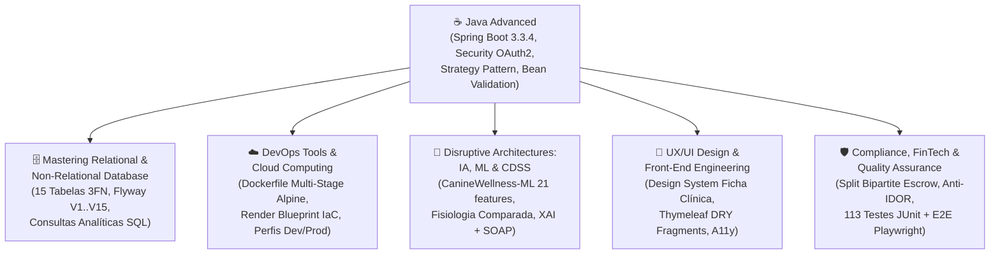

# 🔗 Matriz de Integração Multidisciplinar — 4ª Sprint (Entrega Final FIAP)
**Projeto:** Clyvo Vet Web v2 — Plataforma HealthTech & Marketplace B2B2C de Longevidade Pet  
**Disciplina Âncora:** Java Advanced (Spring Boot 3.3.4, Java 21, Spring Security 6, Spring Data JPA, Flyway, Thymeleaf)

---

## 🎯 Visão Geral da Integração no Semestre
O **Clyvo Vet Web v2** foi arquitetado como uma solução integrada que consolida os conhecimentos práticos de todas as disciplinas do semestre em um único produto funcional, testado e pronto para nuvem. Abaixo estão documentadas as conexões técnicas e as respectivas **evidências auditáveis** dentro deste repositório.

---

## 1. 🗄️ Mastering Relational and Non-Relational Database
### Como a disciplina foi aplicada:
- **Modelagem Relacional em 3ª Forma Normal (3FN):** O domínio evoluiu de um prontuário básico para um ecossistema completo de **15 entidades relacionais** sem redundância de dados, separando autenticação (`T_USUARIO`, `T_TOKEN_RECUPERACAO_SENHA`), cadastro clínico (`T_TUTOR`, `T_RACA`, `T_PET`, `T_HISTORICO_CLINICO`, `T_CHECKIN_DIARIO`, `T_CONSULTA_TRIAGEM`), gamificação (`T_RECOMPENSA_TUTOR`, `T_BADGE_CONQUISTA`) e o livro-razão financeiro do marketplace (`T_CLINICA`, `T_SERVICO`, `T_AGENDAMENTO_SERVICO`, `T_TRANSACAO`, `T_COMISSAO`).
- **Governança de Schema via Flyway (`ddl-auto=none`):** O Hibernate não altera o esquema do banco; todas as tabelas, chaves estrangeiras, restrições de integridade e cargas de catálogo multi-espécie são versionadas em 15 scripts imutáveis (`V1` a `V15`) compatíveis tanto com **H2 Database** quanto com **PostgreSQL 16**.

### 📂 Evidências no Repositório:
- **Migrações Versionadas:** [`src/main/resources/db/migration/V1__criar_tabelas_base.sql`](../src/main/resources/db/migration/V1__criar_tabelas_base.sql) até [`V15__gateway_pagamento_real.sql`](../src/main/resources/db/migration/V15__gateway_pagamento_real.sql).
- **Script SQL Consolidado (DDL + Consultas Analíticas):** [`docs/sql/SCHEMA_E_SEED_CONSOLIDADO_SPRINT4.sql`](sql/SCHEMA_E_SEED_CONSOLIDADO_SPRINT4.sql).

---

## 2. 🧠 Disruptive Architectures: IA, Machine Learning & CDSS
### Como a disciplina foi aplicada:
- **Arquitetura Dual-Engine de Suporte à Decisão Clínica (CDSS):** Implementação de um motor híbrido em camadas (`MotorDecisaoClinicaStrategy`) que separa **Guardrails Clínicos Determinísticos** (diretrizes AAHA/WSAVA para hipertermia, hipotermia e arritmias agudas como *fail-safe override*) da **Inferência Probabilística de Machine Learning**.
- **Modelo Supervisionado `CanineWellness-ML-v1.0`:** Calibrado sobre o dataset *Canine Wellness Classification* (10.000 amostras clínicas, 21 variáveis preditoras, ROC-AUC `0.9485`), calculando a probabilidade multivariada de higidez $P(\text{Higidez} \mid \vec{x})$ via normalização Z-Score e função logística sigmóide.
- **Sistemas Especialistas de Fisiologia Comparada (9 Classes Biológicas):** Motores dedicados para Felinos (`FelinePhysiologyEngine`), Répteis Ectotérmicos (`EctothermicPhysiologyEngine` com POTZ), Peixes (`AquaticPhysiologyEngine`), Aves (`AvianPhysiologyEngine`), Pequenos Mamíferos/Roedores, Mustelídeos, Invertebrados e Equinos.
- **Explicabilidade (XAI) e Registro SOAP:** Decomposição transparente dos pesos positivos e negativos de cada feature no prontuário e geração automática de síntese clínica estruturada no padrão médico veterinário **SOAP** (*Subjetivo, Objetivo, Avaliação, Plano*).

### 📂 Evidências no Repositório:
- **Motores de Inferência:** [`src/main/java/com/fiap/clyvovet/service/engine/`](../src/main/java/com/fiap/clyvovet/service/engine/).
- **Testes de Calibração e Fisiologia Comparada:** [`PredictiveMlEngineTest.java`](../src/test/java/com/fiap/clyvovet/service/PredictiveMlEngineTest.java) e [`LongevidadeCalculadoraMultiEspecieTest.java`](../src/test/java/com/fiap/clyvovet/service/LongevidadeCalculadoraMultiEspecieTest.java).

---

## 3. ☁️ DevOps Tools & Cloud Computing
### Como a disciplina foi aplicada:
- **Containerização Multi-Stage (`Dockerfile`):** Build isolado em estágio Maven com **Eclipse Temurin JDK 21 Alpine** e imagem final enxuta em **JRE 21 Alpine**, parametrizada para injeção dinâmica de porta (`$PORT`) e variáveis de ambiente de produção.
- **Infrastructure as Code (`render.yaml`):** Blueprint declarativo do Render provisionando automaticamente o banco de dados gerenciado PostgreSQL (`clyvo-db`) e o contêiner web (`clyvo-vet-web`) com perfil `prod` ativado.
- **Segregação de Ambientes (`application.properties` vs `application-prod.properties`):** Desativação automática do console H2, de exceções de CSRF e da caixa de credenciais de demonstração quando `SPRING_PROFILES_ACTIVE=prod`.

### 📂 Evidências no Repositório:
- **Container & IaC:** [`Dockerfile`](../Dockerfile) e [`render.yaml`](../render.yaml).
- **Configuração de Produção:** [`src/main/resources/application-prod.properties`](../src/main/resources/application-prod.properties) e [`DataSourceUrlNormalizerConfig.java`](../src/main/java/com/fiap/clyvovet/config/DataSourceUrlNormalizerConfig.java).

---

## 4. 🎨 UX/UI Design, Acessibilidade & Front-End Engineering
### Como a disciplina foi aplicada:
- **Design System Clínico Autoral ("Ficha Clínica"):** Interface projetada com paleta clínica de alto contraste (`#f1f5f9` ardósia clara, `#0f172a` navy chapado na sidebar, `#0d9488` verde-clínico sem gradientes artificiais), tipografia editorial técnica (`Bricolage Grotesque` + `IBM Plex Sans`) e alinhamento numérico tabular (`font-variant-numeric: tabular-nums`) para leitura rápida de sinais vitais e valores financeiros.
- **Reaproveitamento de Templates (Princípio DRY):** Centralização de `<head>`, sidebar responsiva, topbar e alertas globais no fragmento [`fragments/layout.html`](../src/main/resources/templates/fragments/layout.html), utilizado por todas as 21 telas da aplicação.
- **Acessibilidade (WCAG / ARIA):** Rótulos explícitos (`aria-label`) em controles de ícone, semântica `autocomplete` nos fluxos de autenticação e feedback visual claro de validação (`Bean Validation`).

### 📂 Evidências no Repositório:
- **Folha de Estilo & Tokens:** [`src/main/resources/static/css/clyvo.css`](../src/main/resources/static/css/clyvo.css).
- **Layout & Fragmentos Thymeleaf:** [`src/main/resources/templates/fragments/layout.html`](../src/main/resources/templates/fragments/layout.html).

---

## 5. 🛡️ Compliance, FinTech Architecture & Quality Assurance (QA)
### Como a disciplina foi aplicada:
- **Engenharia Financeira Anti-Fuga com Subsídio Paritário (`SplitFinanceiroCalculator`):** Modelagem matemática que garante à clínica parceira um piso mínimo de repasse (**Floor Protection de 75%**) enquanto co-financia paritariamente os descontos de fidelidade do tutor e retém o valor em custódia (**Escrow**) até a validação presencial do Voucher Digital.
- **Segurança Aplicacional (RBAC, Anti-IDOR, Webhook HMAC):** Proteção de rotas por perfil (`ROLE_TUTOR` e `ROLE_ADMIN`), validação de propriedade de pets e agendamentos em todos os endpoints (incluindo polling AJAX de status de pagamento) e verificação criptográfica de assinatura HMAC-SHA256 no webhook da Stripe (`StripeAssinaturaVerificador`).
- **Pirâmide de Testes Automatizados:** **113 testes automatizados** com JUnit 5, Spring Security Test e MockMvc, complementados por inspeção E2E de fluxos completos com **Playwright**.

### 📂 Evidências no Repositório:
- **Calculadora de Split e Custódia:** [`SplitFinanceiroCalculator.java`](../src/main/java/com/fiap/clyvovet/service/SplitFinanceiroCalculator.java) e [`PagamentoSplitService.java`](../src/main/java/com/fiap/clyvovet/service/PagamentoSplitService.java).
- **Suíte de Testes (23 classes / 113 testes):** [`src/test/java/com/fiap/clyvovet/`](../src/test/java/com/fiap/clyvovet/).
- **Pesquisa de Mercado e Dossiê Arquitetural:** [`docs/PESQUISA_DE_MERCADO_CLYVO_VET.md`](PESQUISA_DE_MERCADO_CLYVO_VET.md) e [`docs/DOSSIE_TECNICO_AVALIACAO_CRITICA.md`](DOSSIE_TECNICO_AVALIACAO_CRITICA.md).
